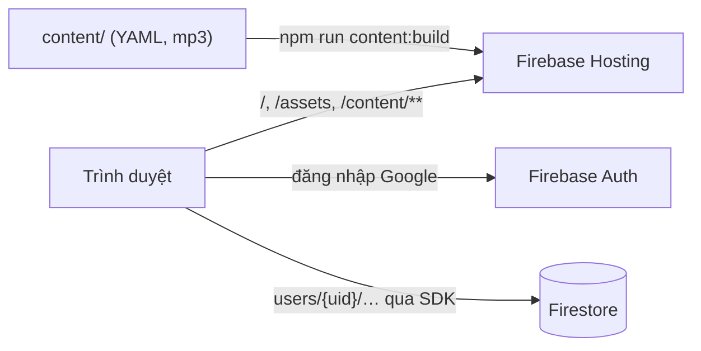

# Kế hoạch deploy DailyLearning lên Firebase (Firestore)

> Ngày lập: 2026-11-02 · Cập nhật: 2026-11-04 · Trạng thái: **Đã chọn và code xong hướng C (không có
> server)**; còn bước tạo project thật, deploy và chuyển dữ liệu (mục 5). Thay cho Phase 8 (VPS)
> trong [`dailylearning-v1-plan.md`](dailylearning-v1-plan.md).

## 1. Ba hướng đã cân nhắc

| Hướng | Dữ liệu người dùng | Nội dung bài học | Chạy logic | Kết quả |
| --- | --- | --- | --- | --- |
| A | Firestore | SQLite read-only trong image | Cloud Run (Fastify) | Bỏ |
| B | Firestore | Firestore | Cloud Run (Fastify) | Bỏ |
| **C** | **Firestore** | **JSON tĩnh trên Hosting** | **Trình duyệt** | **Chọn (2026-11-04)** |

Hướng C không cần Cloud Run, không cần billing (gói Spark đủ), chỉ còn Hosting + Auth + Firestore.
Đổi lại: logic (FSRS, chấm bài, streak, kế hoạch hôm nay) chạy ở client và đáp án câu hỏi / nghe
chép nằm trong file JSON tải về. Chấp nhận được vì là app học cá nhân.

## 2. Kiến trúc đã làm

- `packages/content` (đổi tên từ `apps/server`, bỏ Fastify / drizzle / SQLite): đọc + validate
  `content/`, `content:build` sinh `catalog.json`, `lessons/<slug>.json`, `examples.json` và copy
  mp3. Id số = hash của khóa tự nhiên (lemma, slug, key…) nên ổn định giữa các lần build.
- `apps/web/src/backend/`: trả lời các path `/api/*` cũ ngay trong trình duyệt (router + handlers),
  nên trang và hook React không đổi. `api/client.ts` có transport: mặc định là backend này (lazy
  load), test component dùng `fetch` stub như trước.
- `userStore.ts`: snapshot listener cho profile, `lessonProgress`, `words`, `dailyActivity` (dữ liệu
  nhỏ, 1 người) → mọi màn hình tính từ bộ nhớ, refetch không tốn read. `answers`, `reviewLogs` chỉ
  ghi. Cache offline IndexedDB.
- `firestore.rules`: chỉ chủ tài khoản, chỉ tài khoản có custom claim `learner` (do
  `user:grant` / `migrate:sqlite` gán), log chỉ thêm, kiểm kiểu dữ liệu chính. Đăng nhập bằng
  Google (popup, 2026-11-04): ai cũng đăng nhập được nhưng chưa có claim thì chỉ thấy trang "Chưa
  được cấp quyền".
- Cấu hình Firebase lấy từ `/__/firebase/init.json` của Hosting; dev / e2e dùng project demo trên
  emulator.

## 3. Mô hình dữ liệu Firestore

| Path | Trường | Thay cho bảng SQLite |
| --- | --- | --- |
| `users/{uid}` | `displayName`, `level`, `dailyGoalMin`, `createdAt` | `users` |
| `users/{uid}/lessonProgress/{slug}` | `status`, `step`, `score`, `completedAt`, `updatedAt` | `lesson_progress` |
| `users/{uid}/words/{encodeURIComponent(lemma)}` | `lemma`, `sense` (key), `sourceLesson` (slug), các trường FSRS, `createdAt` | `user_words` |
| `users/{uid}/dailyActivity/{YYYY-MM-DD}` | `secondsStudied`, `lessonsDone`, `reviewsDone` (tăng bằng `increment`) | `daily_activity` |
| `users/{uid}/answers/{auto}` | `lesson`, `question` / `dictation` (index), `value`, `correct`, `answeredAt` | `answers` |
| `users/{uid}/reviewLogs/{auto}` | `lemma`, `rating`, FSRS sau review, `reviewedAt` | `review_logs` |

`sessions`, `app_meta` và mọi bảng nội dung không còn.

## 4. Đã kiểm chứng

- `npm test`: 101 test web (gồm logic FSRS / streak / kế hoạch chuyển từ server) + 89 test content.
- `npm run test:emulator`: 15 test handler + rules trên Auth/Firestore emulator.
- `npm run test:e2e`: đăng nhập → đọc → nghe → ôn → reload → đăng xuất trên Hosting emulator (đúng
  `firebase.json`).
- `migrate:sqlite` với bản copy `data/app.db` thật: chạy 2 lần ra cùng số document; so response của
  server SQLite cũ với handler mới trên dữ liệu đã chuyển (stats, dashboard, today, lessons, sổ từ,
  chi tiết bài, hàng ôn): giống hệt, chỉ khác id số.

## 5. Còn lại (làm tay, theo README → "Deploy lên Firebase")

- [ ] Tạo project, Firestore `asia-southeast1`, bật provider Google.
- [ ] `npx firebase use --add` (alias `prod`), `npm run deploy`.
- [ ] Đăng nhập Google một lần trên site, rồi `migrate:sqlite --project … --email … --dry-run` và chạy
      thật (lệnh này cũng cấp quyền).
- [ ] (Tùy chọn) biến repo cho `deploy.yml` (Workload Identity Federation).
- [ ] (Tùy chọn, cần Blaze) backup Firestore theo lịch; budget alert.
