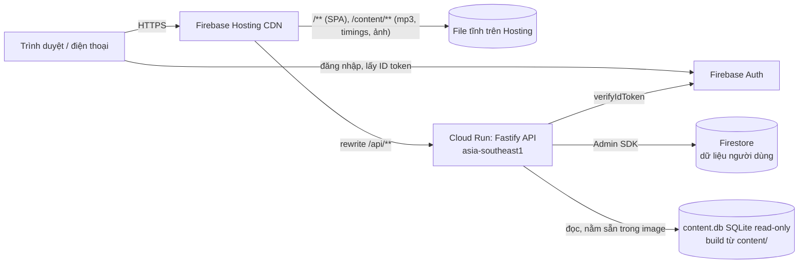

# Kế hoạch deploy DailyLearning lên Firebase (Firestore)

> Ngày lập: 2026-11-02 · Trạng thái: **Đề xuất, chờ chốt các quyết định ở mục 2** · Thay cho Phase 8
> (VPS) trong [`dailylearning-v1-plan.md`](dailylearning-v1-plan.md).

## 1. Hiện trạng và mục tiêu

Hiện tại: một process Node (Fastify) phục vụ cả API `/api/*`, file media `/content/*` và bản build
React (`apps/web/dist`). Dữ liệu nằm trong một file SQLite (`data/app.db`, drizzle) gồm hai loại bảng:

- **Bảng nội dung** (lessons, segments, words, word_senses, lesson_tokens, questions,
  dictation_items, daily_plans_template…): sinh lại được từ `content/` bằng `content:sync`.
- **Bảng người dùng** (users, sessions, lesson_progress, answers, user_words, review_logs,
  daily_activity): tiến độ học, phải giữ và backup.

Mục tiêu: chạy production trên Firebase, **Firestore là database cho dữ liệu người dùng**, có
HTTPS + đăng nhập, deploy tự động từ GitHub, có backup và đường rollback.

## 2. Kiến trúc đề xuất

| Quyết định | Đề xuất | Lý do | Phương án bỏ |
| --- | --- | --- | --- |
| D1. Chạy API ở đâu | **Cloud Run** (container), Hosting rewrite `/api/**` sang service | Giữ nguyên Fastify, chỉ thêm Dockerfile; Hosting rewrite cho web gọi API cùng origin như bây giờ | Cloud Functions v2: phải bọc Fastify qua adapter, Functions tự parse body làm vỡ parser của Fastify. Bỏ server, cho web gọi Firestore trực tiếp: viết lại toàn bộ logic (FSRS, chấm bài, streak) ở client và lộ đáp án |
| D2. Nội dung bài học | **Không đưa vào Firestore**: build `content.db` (SQLite read-only) lúc build image, mọi query nội dung giữ nguyên | Nội dung là build artifact đi theo git, cùng version với code; không tốn read Firestore (một bài có hàng trăm token); không cần bước sync lúc deploy | Đồng bộ nội dung lên Firestore: phải viết lại 14 join của `vocab/queries.ts`, tốn read, cần bước sync tách khỏi deploy code |
| D3. Dữ liệu người dùng | **Firestore** (Native mode, `asia-southeast1`), chỉ server truy cập qua Admin SDK | Đúng yêu cầu; rules chặn hết client nên không phải viết security rules phức tạp | — |
| D4. Đăng nhập | **Firebase Auth** (email/password, tắt tự đăng ký), web gửi `Authorization: Bearer <ID token>`, server `verifyIdToken` + allowlist email | Bỏ được bảng `sessions` + argon2; không vướng giới hạn cookie của Hosting (chỉ chuyển tiếp cookie tên `__session`) | Giữ `AUTH_MODE=password`: phải đổi tên cookie thành `__session` và tự lưu session trong Firestore |
| D5. Media (`*.mp3`, `timings.json`, ảnh) | **Firebase Hosting** (copy vào `dist/content/` lúc build), cache 1 năm, URL vẫn có `?v=` | 28 MB hiện tại (~200 MB khi đủ 200 bài) nằm thoải mái trong hạn mức Hosting, có CDN | Cloud Storage: thêm bucket + CORS + signed URL, không cần với dữ liệu công khai cố định |
| D6. Chạy local | Firestore + Auth **Emulator**, không giữ song song bản SQLite cho dữ liệu người dùng | Một implementation duy nhất, test chạy trên emulator giống prod | Giữ 2 store (SQLite + Firestore) sau một interface: gấp đôi code và test |
| D7. Môi trường | 1 project `daily-learning-prod` + Emulator; preview channel của Hosting cho web | App cá nhân, chưa cần staging riêng | Project staging riêng: thêm sau nếu có người dùng khác |

**Cần anh chốt:** D2 (nội dung không nằm trong Firestore), D4 (Firebase Auth), và Cloud Run
`min-instances` = 0 (miễn phí, cold start ~1–3 s lần mở đầu tiên) hay 1 (không cold start, tốn
khoảng vài USD/tháng).

## 3. Mô hình dữ liệu Firestore

Mọi dữ liệu người dùng nằm dưới `users/{uid}` (uid của Firebase Auth). Tham chiếu tới nội dung bằng
**khóa tự nhiên** (slug, lemma, sense key), không bằng id số của SQLite.

| Collection | Doc id | Trường chính | Thay cho bảng |
| --- | --- | --- | --- |
| `users/{uid}` | uid | `displayName`, `level`, `dailyGoalMin`, `createdAt` | `users` |
| `users/{uid}/lessonProgress/{slug}` | slug bài | `status`, `step`, `score`, `completedAt`, `updatedAt` | `lesson_progress` |
| `users/{uid}/answers/{autoId}` | tự sinh | `lessonSlug`, `target` (`q:<idx>` / `d:<idx>`), `value`, `correct`, `answeredAt` | `answers` |
| `users/{uid}/words/{lemma}` | lemma | `senseKey`, `sourceLessonSlug`, các trường FSRS (`due`, `stability`, `difficulty`, `state`, `reps`, `lapses`, …), `createdAt` | `user_words` |
| `users/{uid}/reviewLogs/{autoId}` | tự sinh | `lemma`, `rating`, `reviewedAt`, `elapsedDays`, `state`, FSRS sau review | `review_logs` |
| `users/{uid}/dailyActivity/{YYYY-MM-DD}` | ngày (Asia/Ho_Chi_Minh) | `secondsStudied`, `lessonsDone`, `reviewsDone` | `daily_activity` |
| `meta/contentKeys` (tuỳ chọn) | — | — | `app_meta` không còn cần |

Ghi chú:

- **Id số trong API giữ nguyên** để không phải sửa `packages/shared` và web: thêm file
  `content/ids.lock.json` (commit vào git) do `content:sync` duy trì — key mới được cấp id mới,
  key cũ giữ id, không tái sử dụng id. Nhờ vậy `content.db` build lại ở mỗi image vẫn ra cùng id,
  server đổi `wordId ↔ lemma` khi đọc/ghi Firestore.
- Index cần khai báo trong `firestore.indexes.json`: `words` theo `due` (hàng ôn tới hạn),
  `answers` theo `answeredAt`, `reviewLogs` theo `reviewedAt`.
- Ghi đồng thời: heartbeat dùng `FieldValue.increment`; chấm thẻ ôn dùng transaction (đọc thẻ →
  tính FSRS → ghi thẻ + log); đếm (thống kê từ vựng, số thẻ tới hạn) dùng `count()` aggregation.
- Ràng buộc `ON DELETE RESTRICT` (không xoá từ điển đã được lưu) không còn ở DB: server bỏ qua /
  báo rõ từ đã lưu mà không còn trong từ điển, CI có bước cảnh báo khi một lemma bị xoá khỏi
  `content/dictionary`.
- `firestore.rules`: `allow read, write: if false;` cho mọi path (chỉ Admin SDK trên server truy cập).

## 4. Các phase

### Phase F0 — Chuẩn bị project Firebase (≈ 0.5 giờ, làm tay trên console)

- [ ] Tạo project `daily-learning-prod`, bật **Blaze** (Cloud Run cần billing) + **budget alert**
      (vd 5 USD/tháng).
- [ ] Firestore Native mode, location `asia-southeast1` (không đổi được sau khi tạo).
- [ ] Auth: bật Email/Password, **tắt cho phép tự đăng ký**, tạo tài khoản của anh.
- [ ] Bật API: Cloud Run, Artifact Registry, Cloud Build, IAM Credentials.
- [ ] `npm i -D firebase-tools`, thêm `firebase.json`, `.firebaserc`, `firestore.rules`,
      `firestore.indexes.json`.

### Phase F1 — Nội dung build-time + id ổn định (≈ 0.5 ngày)

- [ ] `content:sync` đọc/ghi `content/ids.lock.json`; test: build lại DB từ đầu ra cùng id, thêm từ
      mới không đổi id cũ.
- [ ] Tách DB nội dung (`content.db`, mở read-only) khỏi dữ liệu người dùng; script
      `content:build -- --out <path>`.
- [ ] Bỏ auto-sync lúc khởi động khi chạy production (nội dung đã nằm sẵn trong image).

### Phase F2 — Tầng dữ liệu người dùng trên Firestore (≈ 2–3 ngày, phần lớn công việc)

- [ ] Thêm `firebase-admin`; module `src/store/` (một file mỗi nhóm: progress, answers, words,
      reviews, activity, users) — route và service gọi store thay vì drizzle cho bảng người dùng.
- [ ] Viết lại các query trộn nội dung + người dùng (`vocab/queries.ts`, `services/dashboard.ts`,
      `services/daily-plan.ts`, `services/activity.ts`, `reviews/routes.ts`, `lessons/routes.ts`):
      đọc doc người dùng từ Firestore rồi tra nội dung trong `content.db`.
- [ ] Xoá bảng người dùng khỏi schema SQLite (migration mới chỉ còn bảng nội dung).
- [ ] Test chạy trên Firestore Emulator (`firebase emulators:exec --only firestore,auth "npm test"`),
      mỗi test dùng một `uid` ngẫu nhiên hoặc xoá dữ liệu emulator giữa các test. CI cần Java 21.
- [ ] Kiểm lại các tính toán ngày theo `Asia/Ho_Chi_Minh` vẫn đúng khi container chạy UTC.

### Phase F3 — Firebase Auth (≈ 0.5–1 ngày)

- [ ] `AUTH_MODE=firebase`: hook Fastify đọc `Authorization: Bearer`, `verifyIdToken`, kiểm
      `ALLOWED_EMAILS`, tạo `users/{uid}` lần đầu. Bỏ `sessions`, argon2, `user:create`.
- [ ] Web: `firebase/auth` (modular SDK), `LoginPage` dùng `signInWithEmailAndPassword`,
      `api/client.ts` gắn ID token (`getIdToken()` tự làm mới), xử lý 401 → về trang đăng nhập.
- [ ] Local: `AUTH_MODE=none` vẫn dùng được với emulator (user cố định `local`), guard khởi động hiện
      tại vẫn giữ.

### Phase F4 — Hosting cho web + media (≈ 0.5 ngày)

- [ ] Script build copy `content/**/{*.mp3,timings.json,ảnh}` → `apps/web/dist/content/` (không
      copy YAML, cache TTS).
- [ ] `firebase.json`: `public: apps/web/dist`, rewrite `/api/**` → Cloud Run `daily-learning-api`
      (`asia-southeast1`), rewrite `**` → `/index.html`; header `/content/**`
      `Cache-Control: public, max-age=31536000, immutable`, `/index.html` `no-cache`.
- [ ] Server trả `Cache-Control: private, no-store` cho mọi `/api/*` để CDN không cache response
      của người dùng.
- [ ] Production không đăng ký `registerWebStatic` / `registerContentStatic` nữa (vẫn giữ cho local).

### Phase F5 — Container + Cloud Run (≈ 0.5 ngày)

- [ ] `Dockerfile` multi-stage `node:22-slim`: `npm ci` trong container (better-sqlite3 build cho
      Linux, không copy `node_modules` từ Mac), build `shared` + `server`, chạy `content:build`
      → `/app/content.db`; stage cuối chỉ giữ `dist`, prod deps, `content.db`. `.dockerignore` loại
      `content/**/*.mp3`, `data/`, `.env`, `secrets/`.
- [ ] Server đọc `PORT` của Cloud Run, `HOST=0.0.0.0`, `AUTH_MODE=firebase`, log JSON (Cloud
      Logging đọc được sẵn).
- [ ] Service account riêng cho Cloud Run, chỉ có role `roles/datastore.user`.
- [ ] Deploy thử: `gcloud run deploy daily-learning-api --region asia-southeast1 --source .`,
      `--max-instances 2`, `--min-instances 0|1` (theo quyết định mục 2), `--allow-unauthenticated`
      (bảo vệ bằng Firebase Auth ở tầng ứng dụng).

### Phase F6 — Chuyển dữ liệu hiện có (≈ 0.5 ngày)

- [ ] `scripts/migrate-sqlite-to-firestore.ts`: đọc `data/app.db`, map user local (id 1) → uid của
      anh, đổi id số → slug/lemma/sense key, ghi bằng `BulkWriter`. Có `--dry-run` (in số doc từng
      collection) và chạy lại được (doc id cố định → ghi đè, `answers`/`reviewLogs` dùng id tất
      định `sqlite-<id>`).
- [ ] Chạy thử với emulator 2 lần, so số lượng doc với `count(*)` từng bảng SQLite; rồi chạy với prod.
- [ ] Giữ bản `data/app.db` cuối cùng làm backup (không xoá).

### Phase F7 — CI/CD trên GitHub Actions (≈ 0.5 ngày)

- [ ] Xác thực GitHub → Google Cloud bằng **Workload Identity Federation** (không dùng JSON key,
      phù hợp pre-commit đang chặn `private_key`).
- [ ] Job `check` hiện có thêm Firestore Emulator cho `npm test`.
- [ ] Job `deploy` (chỉ trên `main`, sau `check`, có `environment: production` để duyệt tay nếu
      muốn): build + push image lên Artifact Registry → `gcloud run deploy` → `firebase deploy
      --only hosting,firestore:rules,firestore:indexes`. Thứ tự: API trước, web sau, để web mới
      không gọi API cũ.

### Phase F8 — Go-live và vận hành (≈ 0.5 ngày)

- [ ] Smoke test trên URL `*.web.app`: đăng nhập → bài đọc → bài nghe (audio phát, tua câu) → ôn
      từ → Home cập nhật streak; chạy Playwright e2e với `BASE_URL` trỏ vào prod (tài khoản test
      riêng).
- [ ] Custom domain (tuỳ chọn) trong Hosting.
- [ ] **Backup Firestore**: bật scheduled backup hằng ngày, giữ 14 bản (+ PITR 7 ngày nếu muốn).
- [ ] Theo dõi: alert Cloud Monitoring khi tỉ lệ 5xx của Cloud Run > 1% hoặc budget vượt ngưỡng.
- [ ] Rollback: Cloud Run chuyển traffic về revision trước
      (`gcloud run services update-traffic --to-revisions <rev>=100`), Hosting quay lại bản trước
      trên console (Release history → Rollback).
- [ ] Cập nhật README: lệnh emulator, deploy, rollback, biến môi trường mới.

**Tổng ước tính: ~6–8 ngày làm việc**, F2 chiếm nhiều nhất.

## 5. Chi phí ước tính (1 người dùng)

| Dịch vụ | Mức dùng dự kiến | Hạn mức miễn phí (kiểm lại bảng giá trước khi bật) |
| --- | --- | --- |
| Firestore | vài trăm read/write mỗi ngày | 50k read, 20k write/ngày |
| Cloud Run | vài nghìn request/tháng | 2 triệu request/tháng |
| Hosting | ~200 MB lưu trữ, vài MB tải/ngày | 10 GB lưu trữ, 360 MB/ngày |
| Auth | 1 user | miễn phí với email/password |

→ Gần như 0 USD/tháng với `min-instances 0`; `min-instances 1` thêm vài USD.

## 6. Rủi ro và lưu ý

- **Hosting chỉ chuyển tiếp cookie `__session`** sang Cloud Run — lý do chọn Bearer token ở D4.
- **CDN của Hosting có thể cache response API** nếu thiếu `Cache-Control` → luôn `private, no-store`.
- Cold start khi `min-instances 0`: lần mở app đầu tiên trong ngày chậm vài giây.
- Firestore location không đổi được sau khi tạo — chọn đúng `asia-southeast1` ngay từ đầu.
- Rewrite của Hosting sang Cloud Run có timeout 60 s — API hiện tại không có request dài.
- Emulator cần Java; test chậm hơn SQLite in-memory, cần chia test theo uid để chạy song song.
