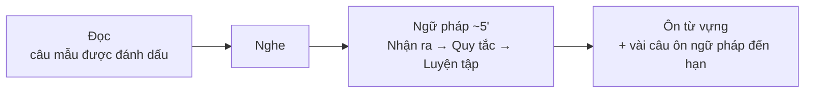
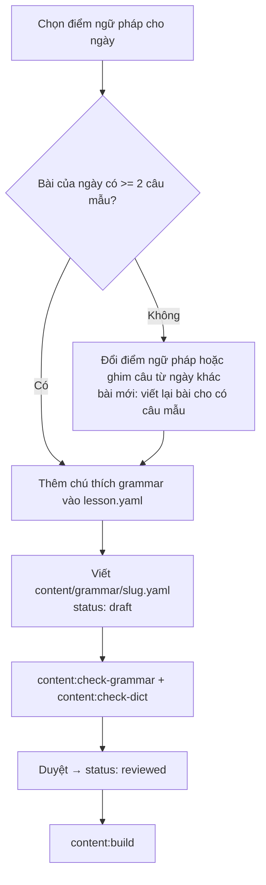

# DailyLearning — Kế hoạch thêm phần Ngữ pháp

> Ngày lập: 2026-11-14 · Trạng thái: **Đã chốt (2026-11-14)** — phương án C (anh chọn), các quyết
> còn lại em kiểm trên nội dung thật rồi chốt (mục 9). Sẵn sàng làm Phase 1.
> Liên quan: [`dailylearning-v1-plan.md`](dailylearning-v1-plan.md) (format bài học, từ điển, daily plan)

## 1. Mục tiêu

- Người học A2 → B1 nắm được **khoảng 30 điểm ngữ pháp cốt lõi**, mỗi ngày học thêm ~5 phút, tổng
  thời gian một ngày vẫn quanh 15–20 phút.
- Ngữ pháp **không tách rời** nội dung đã đọc/nghe: mỗi điểm ngữ pháp được giới thiệu bằng câu thật
  trong bài của ngày hôm đó.
- Có chỗ tra lại khi cần (thư viện ngữ pháp), và có cách ôn để không quên.

## 2. So sánh các cách học

| | A. Bài ngữ pháp riêng | B. Ghép vào bài đọc/nghe | **C. Lai: điểm ngữ pháp của ngày, gắn với bài (đề xuất)** |
|---|---|---|---|
| Cách làm | Mục "Ngữ pháp" độc lập, học theo giáo trình: quy tắc → ví dụ → bài tập | Trong bài đọc, đánh dấu câu có cấu trúc, bấm vào xem giải thích ngắn; không có bài tập riêng | Mỗi ngày có 1 điểm ngữ pháp. Bài đọc/nghe đánh dấu câu mẫu; sau đó là bước **Ngữ pháp** (~5 phút): nhận ra → quy tắc → luyện tập. Có thư viện để tra lại |
| Ngữ cảnh | Câu ví dụ rời rạc, dễ quên | Rất tốt, câu đã đọc và hiểu nghĩa | Tốt: ví dụ đầu tiên luôn lấy từ bài vừa học |
| Tính hệ thống | Tốt, đủ điểm theo lộ trình | Kém: chỉ học được thứ tình cờ có trong bài, thiếu luyện tập | Tốt: lộ trình ngữ pháp định trước, bài mới viết có chủ đích |
| Luyện tập | Có | Không (hoặc rất ít) | Có, chấm ngay |
| Công soạn nội dung | Trung bình | Thấp | Trung bình (thêm file ngữ pháp + chú thích trong `lesson.yaml`) |
| Công code | Trang mới + bài tập | Chỉ thêm highlight + popup | Cả hai, nhưng tái dùng được Quiz, WordCard, TokenizedText |
| Rủi ro | Cảm giác "học giáo trình", bỏ ngang | Không đủ để thật sự dùng đúng ngữ pháp | Ngày học dài thêm ~5 phút |

**Đã chốt: phương án C** (anh chọn 2026-11-14). Lý do:

1. Người học A2 nhớ quy tắc tốt nhất khi **gặp nó trong câu đã hiểu nghĩa trước** (học kiểu
   "nhận ra rồi mới học quy tắc"). Bài đọc của ngày là nguồn câu sẵn có, không tốn thêm công viết ví dụ.
2. Chỉ ghép vào bài đọc (B) thì không có luyện tập, và lộ trình phụ thuộc vào việc bài tình cờ có
   cấu trúc gì. Bản quét 30 bài hiện có (mục 6) cho thấy **hiện tại hoàn thành chỉ có 2 câu**, câu
   điều kiện và `should` mỗi thứ vài câu rải rác — chưa đủ để học, phải viết bài mới có chủ đích.
3. App đã có sẵn hầu hết thành phần: `Quiz` (trắc nghiệm chấm ngay), `Dictation` (điền chỗ trống),
   `TokenizedText` (đánh dấu từ trong câu), `WordCard` (popup), daily plan theo ngày.

## 3. Trải nghiệm người học

### 3.1 Một ngày học



- Trang chủ, khối "Bài học hôm nay" có thêm một bước **Ngữ pháp** giữa Nghe và Ôn từ.
- Bước Ngữ pháp mở được bất cứ lúc nào (không khóa sau Đọc/Nghe), nhưng ví dụ hay nhất khi đã đọc bài.

### 3.2 Trong bài đọc / bài nghe

- Thanh công cụ có nút bật/tắt **"Ngữ pháp trong bài"** (mặc định bật ở bài thuộc ngày có điểm ngữ pháp).
- Khi bật: phần cấu trúc trong câu mẫu được gạch chân màu khác với từ trọng tâm (ví dụ `opened`,
  `worked` trong "Last week, a small coffee shop **opened** on my street").
- Bấm vào phần gạch chân → **GrammarCard** (giống WordCard): tên điểm ngữ pháp, công thức một dòng,
  giải thích ngắn bằng tiếng Việt cho đúng câu này, nút "Học điểm này" mở trang ngữ pháp.
- Bài nghe: chỉ đánh dấu trong lời thoại khi đã hiện lời thoại, không làm lộ đáp án nghe chép.

### 3.3 Trang ngữ pháp `/grammar/:slug` — 3 bước (giống cách chia bước của trang Đọc)

| Bước | Nội dung | Thành phần dùng lại |
|---|---|---|
| 1. Nhận ra | 3–4 câu lấy từ bài đọc/nghe của ngày, phần cấu trúc được tô đậm; một câu hỏi gợi ý ("Các động từ tô đậm có gì chung?") rồi mới hiện đáp án. Mỗi câu có link về đúng câu trong bài | `TokenizedText`, link `?seg=p1s1` |
| 2. Quy tắc | Bảng công thức (khẳng định / phủ định / nghi vấn), cách dùng, dấu hiệu nhận biết, **lỗi người Việt hay mắc** (ví dụ quên `-s` ngôi thứ ba, "I am agree"). Câu ví dụ có audio TTS | Bảng markdown, `AudioPlayer` nhỏ |
| 3. Luyện tập | 6–8 câu, chấm ngay, có giải thích khi sai. Các dạng: trắc nghiệm chọn dạng đúng, điền dạng đúng của động từ, sắp xếp từ thành câu, tìm câu sai | `Quiz`, `Dictation` (mở rộng), component mới `WordOrder` |

Hoàn thành bước 3 (làm hết câu, không bắt buộc đúng hết) = hoàn thành điểm ngữ pháp, giống cách
bài đọc hoàn thành khi trả lời xong câu hỏi.

### 3.4 Thư viện `/grammar`

- Mục mới **Ngữ pháp** trên Sidebar (giữa Nghe và Từ vựng).
- Danh sách theo cấp (A2 / A2+ / B1) và nhóm (Thì, Động từ khuyết thiếu, So sánh, Câu…), trạng thái
  Chưa học / Đang học / Đã học, điểm luyện tập gần nhất.
- Mỗi điểm ngữ pháp liệt kê "Gặp trong bài": các bài có câu được chú thích điểm đó.

### 3.5 Ôn ngữ pháp (phase sau, tùy chọn)

- Mỗi điểm ngữ pháp đã học là **một thẻ FSRS** (dùng lại `ts-fsrs` như thẻ từ).
- Đến hạn → trong màn Ôn từ vựng có thêm 3 câu luyện tập ngẫu nhiên của điểm đó. Mức đánh giá suy ra
  từ kết quả: 3/3 đúng = Dễ, 2/3 = Nhớ, 1/3 = Khó, 0/3 = Quên. Không bắt người học tự chấm.

## 4. Định dạng nội dung

### 4.1 Điểm ngữ pháp: `content/grammar/<slug>.yaml`

```yaml
slug: past-simple-regular
title: Quá khứ đơn – động từ có quy tắc
title_en: Past simple (regular verbs)
level: A2
group: tenses              # tenses | modals | comparison | sentence | nouns | verbs-patterns
summary: Dùng cho việc đã xảy ra và kết thúc trong quá khứ. Động từ thêm -ed.
discover:
  question: Các động từ tô đậm trong 3 câu trên có gì chung? Chúng nói về lúc nào?
  answer: Đều thêm -ed và nói về việc đã xong trong quá khứ (last week, for five years).
  # Câu mẫu lấy tự động từ các bài có chú thích `grammar` trỏ tới slug này (mục 4.2),
  # ưu tiên bài của cùng ngày. Có thể ghim thêm bằng `pinned: [a-new-coffee-shop#p1s1]`.
form:
  - label: Khẳng định
    pattern: S + V-ed
    example: She worked in a hotel.
  - label: Phủ định
    pattern: S + did not (didn't) + V
    example: She didn't work in a bank.
  - label: Nghi vấn
    pattern: Did + S + V?
    example: Did she work in a hotel?
usage:
  - Việc đã xảy ra và kết thúc tại một thời điểm trong quá khứ.
signals: [yesterday, last week, ago, in 2020]
spelling:
  - 'Tận cùng -e: chỉ thêm -d (live → lived)'
  - 'Phụ âm + y: đổi y → ied (study → studied)'
  - 'Nguyên âm ngắn + phụ âm: gấp đôi (stop → stopped)'
common_mistakes:
  - wrong: Did she worked in a hotel?
    right: Did she work in a hotel?
    why: Sau did, động từ trở về nguyên mẫu.
exercises:
  - type: choice
    prompt: Last year we ___ to a new apartment.
    options: [move, moved, moving]
    correct: 1
    explain: '"Last year" là quá khứ → moved.'
  - type: gap                # điền dạng đúng của động từ trong ngoặc
    prompt: She ___ (not / like) the hotel food.
    answer: didn't like
    accept: [did not like]
  - type: order              # sắp xếp từ
    words: [you, did, the, call, landlord]
    answer: Did you call the landlord?
  - type: find_error
    sentence: I watch a film with my friends yesterday.
    wrong: watch
    right: watched
status: draft              # draft | reviewed
```

- Schema Zod mới `grammarPointSchema` trong `packages/shared/src/content.ts`, kiểu riêng cho từng
  loại bài tập (`choice | gap | order | find_error`) bằng `z.discriminatedUnion('type', …)`.
- Câu ví dụ trong `form`, `exercises` dùng từ đã có trong từ điển → bấm được vào từ như bài đọc
  (kiểm bằng `content:check-dict`, cảnh báo chứ không báo lỗi).

### 4.2 Chú thích trong bài: `lesson.yaml`

```yaml
grammar:
  - point: past-simple-regular
    segment: p1s1
    match: opened              # phần được gạch chân; phải xuất hiện trong text_en của segment
  - point: past-simple-regular
    segment: p1s4
    match: worked
    note: '"for five years" + quá khứ đơn: việc kéo dài nhưng đã kết thúc.'   # tùy chọn, hiện trong GrammarCard
```

- `match` có thể là cụm không liền nhau bằng `…`: `match: "is … going to"`.
- Validate: `point` phải tồn tại trong `content/grammar/`, `match` phải tìm thấy trong segment.

### 4.3 Lộ trình: `content/daily-plan.yaml`

```yaml
  - day: 2
    title: Công việc mới
    reading: my-first-week-at-a-new-job
    listening: introducing-yourself-at-work
    grammar: past-simple-regular      # tùy chọn; ngày không có thì bỏ qua bước Ngữ pháp
```

### 4.4 Build

- `npm run content:build` đọc thêm `content/grammar/`, ghi vào `catalog.json` danh sách điểm ngữ pháp
  (slug, title, level, group, số bài liên quan) và một file `grammar/<slug>.json` cho mỗi điểm (giống
  cách đang tách `LessonData`).
- Script mới `npm run content:check-grammar [slug]`:
  - liệt kê chú thích `grammar` lỗi (point không tồn tại, `match` không khớp);
  - với mỗi điểm trong lộ trình, đếm số câu mẫu trong bài của ngày đó, cảnh báo nếu < 2;
  - gợi ý câu có thể chú thích (regex theo từng điểm, ví dụ `\b(have|has) \w+ed\b`) để soạn nhanh.
- CI (`content:build --dry-run`) báo lỗi khi validate hỏng, giống từ điển.

## 5. Dữ liệu người học (Firestore) và code

### 5.1 Firestore

```
users/{uid}/grammarProgress/{slug}
  status: not_started | in_progress | completed
  step: 0 | 1 | 2
  lastScore: int            # số câu đúng lần làm gần nhất
  total: int
  completedAt: timestamp | null
  updatedAt: timestamp
  # phase ôn (3.5): thêm các trường thẻ FSRS, dùng lại hàm isCard() trong firestore.rules
```

- Thêm rule cho `grammarProgress/{slug}` trong `firestore.rules` (cùng kiểu `lessonProgress`), có test emulator.
- Câu trả lời từng bài tập ghi vào collection `answers` sẵn có (thêm trường `grammar: slug`), để
  thống kê câu hay sai.

### 5.2 Các file chính sẽ đụng

| Khu vực | File |
|---|---|
| Schema / type | `packages/shared/src/content.ts`, `content-data.ts`, `api.ts` (`TodayStepDto.kind` thêm `'grammar'`), `constants.ts` (`GRAMMAR_GROUPS`) |
| Build / check | `scripts/content-build.ts`, `scripts/content-grammar-check.ts` (mới), `scripts/content-stats.ts` |
| Backend (chạy trong web) | `apps/web/src/backend/content.ts`, `handlers.ts`, `router.ts`, `userStore.ts`, `logic/dailyPlan.ts` (`PlanDay.grammarSlug`, `grammarStep()`) |
| UI | `pages/Grammar/GrammarPage.tsx` + `GrammarLibraryPage.tsx` (mới), `components/GrammarCard/`, `components/WordOrder/` (mới), `components/TokenizedText` (thêm lớp gạch chân ngữ pháp), `pages/Reading/ReadingPage.tsx`, `pages/Listening/ListeningPage.tsx`, `pages/Home/HomePage.tsx`, `components/Sidebar/Sidebar.tsx`, `App.tsx` |
| Rules / test | `firestore.rules`, `apps/web/test/*`, `apps/web/test/emulator/*`, `e2e/learning-flow.spec.ts` |

### 5.3 Ảnh hưởng tới "ngày đã xong"

Hiện `pickToday` coi một ngày xong khi bài đọc và bài nghe xong. Có hai lựa chọn:

- (a) Ngữ pháp bắt buộc: ngày chỉ xong khi cả Ngữ pháp xong → người đang ở giữa lộ trình (đã
  qua ngày 1–15) sẽ bị kéo về ngày 1 nếu không có quy tắc chuyển tiếp.
- **(b) Ngữ pháp tùy chọn — Đã chốt.** Ngày xong như cũ (`pickToday` và `isDone` không đổi); bước
  Ngữ pháp hiện trên trang chủ với trạng thái riêng nhưng không chặn sang ngày mới.
  - Khi ngày đang "giữ lại vì đã xong hôm nay" (stay rule) mà Ngữ pháp chưa làm, bước Ngữ pháp vẫn
    hiện "Chưa học" để người học làm nốt.
  - Điểm ngữ pháp của các ngày đã qua (người học cũ) hiện ở thư viện là "Chưa học", trang chủ có một
    dòng gợi ý "Còn N điểm ngữ pháp của các ngày trước" dẫn tới `/grammar`.
  - Trang ngữ pháp chạy `useStudyTimer` như trang Đọc/Nghe, nên thời gian học vẫn tính vào
    `dailyActivity` (biểu đồ tuần, mục tiêu phút/ngày).

## 6. Lộ trình ngữ pháp (bản nháp)

### 6.1 Ngày 1–15: gán vào bài đã có — Đã chốt

Đã kiểm bằng cách đọc toàn văn bài đọc + bài nghe của từng ngày (2026-11-14). Mọi ngày đều có
**≥ 2 câu mẫu ngay trong bài của ngày đó**, nên **không cần sửa bài cũ** (không phải tạo lại audio).
Bản nháp trước gán `will` cho ngày 4, `should / have to` cho ngày 5, `much / many` cho ngày 10,
`V-ing` cho ngày 14 — kiểm ra mỗi ngày chỉ có 1–2 câu yếu, nên đổi sang điểm mà bài thật sự có.

| Ngày | Chủ đề | Điểm ngữ pháp (slug) | Câu mẫu trong bài của ngày (segment) |
|---|---|---|---|
| 1 | Cuộc sống quanh khu phố | Hiện tại đơn + trạng từ tần suất (`present-simple-frequency`) | "I **usually go** there…" (coffee-shop p3s1), "**sometimes** a piece of banana cake" (p3s2), "the staff **are always** friendly" (p3s3), "It **stops** at every station" (train-station l4) |
| 2 | Công việc mới | Quá khứ đơn – có quy tắc (`past-simple-regular`) | "**arrived** at the office" (new-job p1s3), "**showed** me my desk" (p2s1), "**introduced** me" (p2s2), "I **worked** at a bank" (introducing l7) |
| 3 | Ăn uống | Đếm được / không đếm được: some, a few, a little, much (`countable-uncountable`) | "**some** chicken… **a few** eggs" (cooking p2s2), "**a little** fish sauce" (p3s3), "**too much** salt" (p4s1), "**How much** is that?" (ordering l6), "**some** food" (l2) |
| 4 | Mua sắm | `too` + tính từ (`too-adjective`) | "the sleeves were **too long**" (shopping), "it's **too small**" (returning-a-shirt), "that's **too bad**" (returning-a-shirt) |
| 5 | Sức khỏe | Động từ + to V / V-ing (`verb-to-or-ing`) | "**decided to change**", "**stopped using** my phone", "**try to go** to bed", "**started to fall** asleep" (better-sleep), "I'd **like to make** an appointment" (doctor) |
| 6 | Du lịch | Quá khứ đơn – bất quy tắc (`past-simple-irregular`) | "We **went** by bus… the trip **took**" (da-lat p1s3), "we **had** coffee" (p2s3), "**ate** street food" (p3s3), ~20 động từ |
| 7 | Giao tiếp ở công ty | Nhờ và xin phép lịch sự: can / could (`can-could-requests`) | "**Could you write** the summary?" (meeting l11), "When **can you finish** it?" (l5), "He **can show** you…" (email p3s3) |
| 8 | Cuối tuần | Kế hoạch tương lai: be going to và hiện tại tiếp diễn (`future-plans`) | "I'm **going to sleep in**" (weekend-plans p2s1), "my cousin **is having** a birthday party" (p3s1); ghim thêm "I'm **going to keep**…" (ngày 5), "I'm **going to save**…" (ngày 10) |
| 9 | Công nghệ | can / can't – khả năng (`can-ability`) | "My laptop **can't connect**" (wi-fi l2), "**Can you see** the router?" (l5), "I **can see** the website" (l12) |
| 10 | Tiền bạc | have to / had to / need to – sự cần thiết (`have-to-need-to`) | "I **had to borrow** money" (saving), "I **need** it for my salary", "I **need to see** your passport" (bank); ghim "you **have to be** careful" (ngày 4), "I **have to work**" (ngày 5) |
| 11 | Gia đình | So sánh hơn và so sánh nhất (`comparatives-superlatives`) | "my **younger** brother" (sunday-lunch p1s3), "**getting older**" (p4s2), "**the most important** day" (p4s3); ghim "**one size bigger**", "made them **shorter**" (ngày 4), "**much better than** takeout" (ngày 3) |
| 12 | Thời tiết | will – dự đoán và quyết định tức thì (`will-predictions-decisions`) | "Saturday **will be** sunny" (l5), "Sunday **will be** cloudy" (l7), "**I'll swim** on Saturday morning" (l10), "**I'll bring** you back some dried squid" (l14) |
| 13 | Nhà ở | Hiện tại tiếp diễn và hiện tại đơn (`present-continuous-vs-simple`) | "I'm slowly **buying** furniture… a new sofa **is coming**" (apartment p4s3), "the kitchen sink **is leaking**" (landlord l11); ghim "I am slowly **getting** used to…" (ngày 2) |
| 14 | Thể thao và sở thích | Từ nối thời gian khi kể chuyện: when, while, after, at first (`time-linkers`) | "**When** I was a child…", "I stayed on the sand **while** they swam", "**At first**, I was afraid…", "**After** two months, I could swim…" (learning-to-swim) |
| 15 | Học tập | **Ôn tập tổng hợp** ngày 1–14 (`review-days-1-14`): bài luyện trộn, không có quy tắc mới | Lấy câu luyện tập từ 14 điểm trước |

- "Ghim" = câu ở bài của ngày khác, khai báo qua `discover.pinned` (mục 4.1). Bước "Nhận ra" luôn ưu
  tiên câu của ngày hôm đó, câu ghim chỉ bổ sung.
- Bài nghe dùng dấu nháy cong (`it’s`) trong `text_en`: `match` của chú thích `grammar` so khớp sau
  khi chuẩn hóa `’` → `'` (giống `normalizeDictation`), để không phải sửa bài.
- Sau này nếu một điểm thiếu câu mẫu: ưu tiên đổi điểm hoặc ghim câu từ ngày khác; chỉ sửa bài cũ khi
  không còn cách khác, tối đa 2 câu / bài, giữ nguyên câu hỏi và nghe chép.

### 6.2 Ngày 16–30 trở đi: viết bài mới có chủ đích (hướng B1)

Từ đây **chọn điểm ngữ pháp trước, viết bài sau**: khi soạn `lesson.yaml` mới, đưa vào yêu cầu
"bài đọc dùng tự nhiên 3–5 câu với cấu trúc X", rồi chú thích `grammar` luôn.

Danh sách theo thứ tự (A2+ → B1). Cột cuối là câu đã có trong bài cũ, dùng làm câu ghim:

| # | Điểm ngữ pháp | Câu ghim có sẵn |
|---|---|---|
| 16 | `should / shouldn't` – lời khuyên | "I **should come back** on Saturday evening" (ngày 12), vài câu ở ngày 7, 11, 15 |
| 17 | Câu điều kiện loại 0 và 1 | "**If** it says rain, I leave work early…" (ngày 12), "it's free **if** you keep…" (ngày 10) |
| 18 | Quá khứ tiếp diễn (was / were + V-ing, when / while) | — |
| 19 | could / couldn't – khả năng trong quá khứ | "I **could swim**…" (ngày 14), "I **couldn't focus**" (ngày 5) |
| 20 | Hiện tại hoàn thành: ever / never, kinh nghiệm | — |
| 21 | Hiện tại hoàn thành với for / since | "I**'ve had** a bad cough **since** Monday" (ngày 5), "How long **have** you **worked** here?" (ngày 2) |
| 22 | Hiện tại hoàn thành và quá khứ đơn | — |
| 23 | `used to` | (1 câu rải rác, kiểm khi soạn) |
| 24 | Mệnh đề quan hệ who / which / that | rải rác ở 12 bài |
| 25 | `enough` và `too` (ôn ngày 4) | "I have **enough** savings" (ngày 10), "One page is **enough**" (ngày 7) |
| 26 | Bị động hiện tại và quá khứ | — |
| 27 | `might / may` – khả năng | "I heard it **might rain**" (ngày 12) |
| 28 | Câu điều kiện loại 2 | — |
| 29 | Câu tường thuật cơ bản (said / told) | "Many buyers **said** the jacket was a little small" (ngày 4), "She **said**, …" (ngày 5) |
| 30 | Ôn tập tổng hợp | — |

Mạo từ a / an / the và đại từ bất định (something, anyone…) không làm điểm riêng ở chặng này, chỉ
đưa vào mục "lỗi người Việt hay mắc" của các điểm liên quan.

## 7. Các phase

| Phase | Nội dung | Xong khi |
|---|---|---|
| **1. Nội dung và schema** | `grammarPointSchema`, chú thích `grammar` trong `lessonSchema`, `grammar` trong daily plan; `content:build` ghi catalog + file từng điểm; `content:check-grammar`. Soạn thử 3 điểm (ngày 1, 2, 6) | `content:build` xanh, test schema (Vitest) cho từng loại bài tập và lỗi validate |
| **2. Trang ngữ pháp** | `/grammar/:slug` 3 bước, component `WordOrder`, mở rộng chấm điền chỗ trống (dùng lại `normalizeDictation`); `/grammar` thư viện; mục Sidebar | Test component + axe; chạy thật trên dev server 3 điểm thử |
| **3. Gắn vào bài đọc / nghe** | Gạch chân trong `TokenizedText`, `GrammarCard`, nút bật/tắt; link câu mẫu → đúng câu trong bài | Test ReadingPage/ListeningPage; đáp án nghe chép không bị lộ |
| **4. Tiến độ và trang chủ** | `grammarProgress` + rules + test emulator; bước Ngữ pháp trong "Bài học hôm nay" theo lựa chọn 5.3; thống kê trên trang chủ | Test emulator rules, `dailyPlan` unit test, E2E thêm bước Ngữ pháp vào `learning-flow.spec.ts` |
| **5. Soạn đủ nội dung ngày 1–15** | 14 điểm + bài ôn tập theo bảng 6.1; chú thích câu mẫu (không sửa bài cũ); TTS câu ví dụ | `content:check-grammar` không còn cảnh báo cho ngày 1–15; anh duyệt `status: reviewed` |
| **6. Ôn ngữ pháp bằng FSRS** (tùy chọn) | Thẻ FSRS cho mỗi điểm; câu ôn trộn vào màn Ôn từ vựng | Unit test chấm điểm → rating; E2E một lượt ôn |

Phase 1–4 là phần code (làm trước, mỗi phase một commit / MR). Phase 5 làm song song với việc viết
bài cho ngày 16+ theo quy trình soạn bài hiện tại (Claude soạn → check → duyệt).

**Quy trình soạn một điểm ngữ pháp (bổ sung vào quy trình ở plan v1, mục 2.5)**



## 8. Ước tính khối lượng

- Code Phase 1–4: khoảng 4–6 phiên làm việc (giả định, đo lại sau Phase 1).
- Nội dung: một điểm ngữ pháp ~1,5–2 KB YAML, 6–8 bài tập. 15 điểm ngày 1–15 ≈ 30 KB.
- TTS câu ví dụ: ~15 điểm × ~10 câu × ~50 ký tự ≈ 7.500 ký tự, nằm trong hạn mức miễn phí.

## 9. Quyết định đã chốt (2026-11-14)

| # | Câu hỏi | Chốt | Căn cứ |
|---|---|---|---|
| 1 | Cách học: A / B / C | **C** — điểm ngữ pháp của ngày, gắn với bài | Anh chọn |
| 2 | Bước Ngữ pháp có bắt buộc để hoàn thành ngày không | **Tùy chọn** (mục 5.3 b) | Không đổi `pickToday`, không kéo người học cũ về ngày 1, streak giữ nguyên. Xem lại sau 2 tuần dùng thử: nếu bước Ngữ pháp hay bị bỏ thì mới cân nhắc bắt buộc |
| 3 | Ngôn ngữ giải thích | **Tiếng Việt**, thuật ngữ kèm tên tiếng Anh (Quá khứ đơn – Past simple) | Người học A2 hiểu quy tắc nhanh nhất bằng tiếng mẹ đẻ; tên tiếng Anh để tra thêm được. Câu ví dụ và bài tập vẫn bằng tiếng Anh, có bản dịch khi bấm |
| 4 | Có làm Phase 6 (ôn bằng FSRS) | **Có, sau Phase 1–5** | Học xong không ôn thì quên; FSRS đã có sẵn (`ts-fsrs`, `isCard()` trong rules). Làm sau để có đủ bài tập trong kho câu trước |
| 5 | Sửa bài cũ để đủ câu mẫu | **Không cần** cho ngày 1–15 | Đọc toàn văn đã thấy đổi điểm ngữ pháp ở ngày 4, 5, 10, 14 là đủ câu mẫu (mục 6.1). Không phải tạo lại audio / `timings.json` |
| 6 | Danh sách ngày 1–15 | **Bảng 6.1** (đã kiểm từng câu) | Mỗi ngày ≥ 2 câu mẫu trong bài của chính ngày đó |
