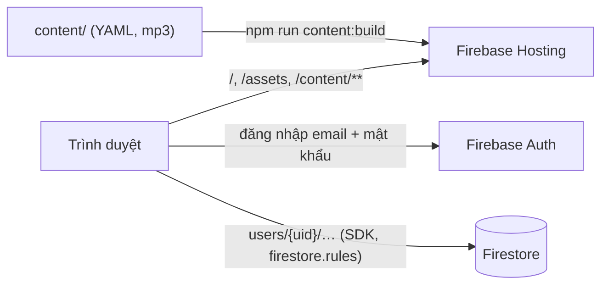

# DailyLearning

Web app học tiếng Anh ~15 phút mỗi ngày, tập trung **Đọc** và **Nghe** (A2 → B1). Chạy trên
**Firebase**, không có server riêng: trang web (Firebase Hosting) đọc bài học từ file JSON tĩnh và
lưu tiến độ của người học thẳng vào **Firestore**. Kế hoạch: [`.claude/plans/dailylearning-v1-plan.md`](.claude/plans/dailylearning-v1-plan.md),
chuyển sang Firebase: [`.claude/plans/firebase-deploy-plan.md`](.claude/plans/firebase-deploy-plan.md).

## Kiến trúc



- **Bài học, từ điển, lộ trình**: `npm run content:build` biến `content/` thành
  `/content/data/*.json` (+ copy mp3) và đi cùng bản build web lên Hosting. Không nằm trong
  Firestore.
- **Tiến độ người học**: Firestore, mỗi người một cây `users/{uid}/…` (bảng dưới). `firestore.rules`
  chỉ cho đúng chủ tài khoản đọc / ghi, và chỉ tài khoản có claim `learner` (tạo bằng
  `npm run user:create`). App không có màn hình đăng ký.
- **"API" chạy ngay trong trình duyệt**: các trang vẫn gọi `api('/lessons')`, `api('/reviews/due')`…
  như trước; `apps/web/src/backend/` trả lời các path đó từ file JSON + Firestore (FSRS, chấm bài,
  streak, kế hoạch hôm nay đều tính ở client). Kiểu dữ liệu chung: `packages/shared/src/api.ts`.

| Firestore                           | Nội dung                                       |
| ----------------------------------- | ---------------------------------------------- |
| `users/{uid}`                       | tên hiển thị, trình độ, mục tiêu phút mỗi ngày |
| `users/{uid}/lessonProgress/{slug}` | trạng thái, bước, điểm của một bài             |
| `users/{uid}/words/{lemma}`         | từ đã lưu + thẻ FSRS                           |
| `users/{uid}/dailyActivity/{ngày}`  | giây học, số bài, số lượt ôn trong ngày (VN)   |
| `users/{uid}/answers/{id}`          | mọi câu trả lời (chỉ thêm, không sửa)          |
| `users/{uid}/reviewLogs/{id}`       | mọi lượt chấm thẻ (chỉ thêm, không sửa)        |

Dữ liệu người học tham chiếu nội dung bằng khóa tự nhiên (slug, lemma, key nghĩa), không bằng id
số. Id số trong JSON là hash của khóa tự nhiên nên ổn định giữa các lần build.

## Yêu cầu

- **Node.js 22** qua [nvm](https://github.com/nvm-sh/nvm): `nvm install` rồi `nvm use` (đọc `.nvmrc`).
- **Java 21** cho Firebase Emulator (dev, test): `brew install openjdk@21` rồi thêm vào `PATH`:
  `export PATH="/opt/homebrew/opt/openjdk@21/bin:$PATH"` (vd trong `~/.zshrc`).
- **ffmpeg** (chỉ cần khi tạo audio): `brew install ffmpeg` (có kèm `ffprobe`).
- `firebase-tools` đã nằm trong devDependencies (`npx firebase …`), không cần cài global.

## Chạy local (emulator, không cần project Firebase thật)

```bash
nvm use
npm install
cp -n .env.example .env              # chỉ cần cho content:tts

npm run dev                          # content:build + Auth/Firestore emulator + Vite
```

Lần đầu, ở terminal khác, tạo tài khoản đăng nhập trong emulator:

```bash
npm run user:create -- you@example.com --emulator --name Viet
```

Mở **http://127.0.0.1:5173** và đăng nhập. Dữ liệu emulator được lưu ở `tmp/emulator-data/` khi tắt
`npm run dev` (Ctrl+C) và nạp lại lần sau. Emulator UI: http://127.0.0.1:4000. Cổng: Auth 9099,
Firestore 8180, Hosting 5002 (`firebase.json`).

## Deploy lên Firebase

### Lần đầu

1. [Firebase console](https://console.firebase.google.com) → tạo project (gói **Spark** miễn phí
   là đủ; cần **Blaze** nếu muốn bật backup Firestore theo lịch).
2. **Firestore Database** → Create database, Native mode, location **`asia-southeast1`**
   (không đổi được về sau).
3. **Authentication** → Sign-in method → bật **Email/Password**.
4. Gắn project vào repo và deploy lần đầu:

   ```bash
   npx firebase login
   npx firebase use --add               # chọn project, đặt alias: prod
   npm run deploy                       # build + hosting + firestore.rules + indexes
   ```

5. Tạo tài khoản thật. Script dùng Admin SDK nên cần credential: tải key service account
   (Project settings → Service accounts → Generate new private key) vào `secrets/` (đã gitignore,
   pre-commit chặn file có `private_key`):

   ```bash
   export GOOGLE_APPLICATION_CREDENTIALS=secrets/<file>.json
   npm run user:create -- you@example.com --project <project-id> --name Viet
   ```

6. Chuyển tiến độ cũ từ SQLite (bản chạy local trước đây) sang tài khoản vừa tạo:

   ```bash
   npm run migrate:sqlite -- --project <project-id> --email you@example.com --dry-run   # đếm trước
   npm run migrate:sqlite -- --project <project-id> --email you@example.com
   ```

   Script chỉ đọc `data/app.db`, id document cố định nên chạy lại không tạo bản trùng. Xong thì
   xoá key trong `secrets/` nếu không cần nữa.

Site chạy ở `https://<project-id>.web.app`. Cấu hình Firebase của web lấy từ
`/__/firebase/init.json` do Hosting tự phục vụ, nên không có gì phải điền vào code.

### Các lần sau

- Bằng tay: `npm run deploy` (`FIREBASE_PROJECT=<alias|id> npm run deploy` để chọn project khác
  `prod`).
- Tự động: `.github/workflows/deploy.yml` deploy sau khi CI xanh trên `main`, khi repo có các
  biến (Settings → Variables): `FIREBASE_PROJECT_ID`, `GCP_WORKLOAD_IDENTITY_PROVIDER`,
  `GCP_SERVICE_ACCOUNT` (Workload Identity Federation, không dùng JSON key; service account cần
  quyền Firebase Hosting Admin + Firebase Rules Admin + Cloud Datastore Index Admin). Chưa đặt
  `FIREBASE_PROJECT_ID` thì workflow bỏ qua.
- Rollback web: Hosting → Release history → Rollback.

## Lệnh

| Lệnh                                | Tác dụng                                                                      |
| ----------------------------------- | ----------------------------------------------------------------------------- |
| `npm run dev`                       | `content:build` + emulator Auth/Firestore + Vite (http://127.0.0.1:5173)      |
| `npm run emulators`                 | Chỉ emulator (dữ liệu giữ ở `tmp/emulator-data/`)                             |
| `npm run build`                     | `content:build` + build web vào `apps/web/dist` (đúng thứ được deploy)        |
| `npm run deploy`                    | Build rồi deploy Hosting + Firestore rules/indexes lên project `prod`         |
| `npm run lint` / `typecheck`        | ESLint / `tsc --noEmit` (mọi workspace + `e2e/`)                              |
| `npm test`                          | Vitest: web (component, a11y, logic FSRS/streak/kế hoạch) + content tooling   |
| `npm run test:emulator`             | Backend trong trình duyệt + `firestore.rules`, chạy trên emulator             |
| `npm run test:e2e`                  | Build bản `e2e`, chạy Playwright trên Hosting + Auth + Firestore emulator     |
| `npm run content:build`             | Validate `content/`, ghi `apps/web/public/content/` (JSON + mp3)              |
| `npm run content:check`             | Chỉ validate (CI)                                                             |
| `npm run content:check-dict [slug]` | Từ trong bài chưa có trong từ điển, từ nhiều nghĩa chưa chọn nghĩa            |
| `npm run content:stats`             | Số entry, % `reviewed`, độ phủ Oxford 3000, số bài                            |
| `npm run content:tts:voices`        | Liệt kê giọng en-US (`-- --sample`: file nghe thử trong `tmp/voice-samples/`) |
| `npm run content:tts -- <slug>`     | Audio bài: `audio.mp3` + `timings.json` (`--all`, `--dry-run`, `--force`)     |
| `npm run content:tts-words`         | Phát âm từ `content/words/<lemma>.mp3` cho từ chưa có audio                   |
| `npm run user:create -- <email> …`  | Tạo tài khoản + claim `learner` (`--emulator` hoặc `--project <id>`)          |
| `npm run migrate:sqlite -- …`       | Copy tiến độ từ `data/app.db` cũ sang Firestore (`--dry-run` để đếm trước)    |
| `npm run format`                    | Prettier (ghi); `format:check` chỉ kiểm tra                                   |

## Cấu trúc thư mục

```
apps/web/          React 18 + Vite
  src/backend/     "API" chạy trong trình duyệt: router, handlers, Firestore (userStore), content
  src/pages/ …     giao diện (gọi api('/…') qua src/api/)
  test/            component + logic (jsdom); test/emulator/: backend + rules trên emulator
packages/shared/   kiểu API, kiểu file nội dung (content-data), schema YAML (zod)
packages/content/  tooling nội dung: đọc/validate YAML, tách từ, content:build, TTS
content/           bài học, từ điển, lộ trình, audio (nguồn của content:build)
scripts/           content-*.ts, tts*.ts, user-create.ts, migrate-sqlite-to-firestore.ts
e2e/               Playwright (đăng nhập → đọc → nghe → ôn từ)
firebase.json      Hosting (rewrite SPA, cache header), Firestore, cổng emulator
firestore.rules    quyền truy cập Firestore
```

## Thêm bài học mới

Quy trình soạn bài (kế hoạch mục 2.5):

1. Viết `content/lessons/a2/<slug>/lesson.yaml` (bài, bản dịch, câu hỏi, nghe chép, focus words,
   `senses`, `ignore`) và thêm bài vào `content/daily-plan.yaml` nếu muốn đưa vào lộ trình.
2. `npm run content:check-dict <slug>` → liệt kê token chưa có trong từ điển và từ nhiều nghĩa chưa
   được chọn nghĩa.
3. Tạo các file `content/dictionary/<lemma>.yaml` còn thiếu (`status: draft`), chọn nghĩa đúng câu
   trong bài (`senses: { run: manage }`, lần xuất hiện thứ 2: `run#2: move`).
4. Duyệt lại → đổi sang `status: reviewed`.
5. `npm run content:tts -- <slug>` và `npm run content:tts-words` (mục dưới).
6. `npm run content:check` phải báo OK trước khi commit (CI cũng chạy lệnh này). Deploy để đưa bài
   lên site.

Không xoá file từ điển của một từ người học đã lưu: từ đó sẽ biến khỏi sổ từ và hàng ôn (dữ liệu
trong Firestore vẫn còn, thêm lại file là hiện lại).

Schema: `packages/shared/src/content.ts`. Quy tắc tách từ: `packages/content/src/content/tokenizer.ts`
(cụm dài nhất trước, dạng từ → từ gốc, `ignore`, bỏ qua số; từ viết tắt như `it's` / `I'll` là entry
riêng, `there's` là dạng của `there is`).

## Tạo audio (chạy trên Mac)

Audio tạo một lần bằng Google Cloud Text-to-Speech (kế hoạch 2.4) rồi commit vào git; app không gọi
TTS khi đang học. Cần `GOOGLE_TTS_API_KEY` trong `.env` (API key chỉ cho phép Text-to-Speech API).
Trước lần chạy đầu, đặt **budget alert** trong Google Cloud Billing (ví dụ 1 USD).

Chạy theo thứ tự:

```bash
brew install ffmpeg                          # ffmpeg + ffprobe (script kiểm tra lúc bắt đầu)

npm run content:tts:voices -- --sample       # liệt kê giọng + 8 file nghe thử trong tmp/voice-samples/
open tmp/voice-samples                       # nghe rồi sửa content/tts.config.yaml
                                             # (speakerA, speakerB, narrator, word)

npm run content:tts -- --all --dry-run       # chỉ đếm ký tự, không gửi gì
npm run content:tts -- --all                 # audio.mp3 + timings.json cạnh mỗi lesson.yaml

npm run content:tts-words -- --dry-run       # tùy chọn: đếm trước
npm run content:tts-words                    # content/words/<lemma-slug>.mp3

npm run content:build                        # timings, thời lượng, waveform, audio từ → JSON

git add content && git commit -m "content: add lesson and word audio"
```

Cách hoạt động:

- Mỗi câu một clip (giọng A/B cho bài nghe, giọng `narrator` cho bài đọc), ghép bằng ffmpeg với
  `gapMs` khoảng lặng, chuẩn hóa MP3 mono 64 kbps. `timings.json` chứa mốc từng câu (đo bằng ffprobe),
  thời lượng và 80 điểm waveform.
- Mỗi lần chạy in số ký tự sẽ gửi và dừng trước khi gọi API nếu vượt `TTS_MAX_CHARS` (mặc định
  50000). `--dry-run` chỉ in số ký tự (không cần key, không cần ffmpeg).
- Cache: `content/.tts-cache.json` + `content/.tts-clips/` (đều gitignore). Clip đã có không gửi lại.
  Bài có `timings.json` khớp nội dung được bỏ qua; đổi giọng thì dùng `--force` (chỉ tạo lại clip của
  giọng mới).
- Giọng Chirp 3 HD chỉ nhận văn bản thường và bỏ qua `speakingRate`; Neural2 và WaveNet dùng
  `speakingRate` trong `content/tts.config.yaml`. Tên giọng được kiểm tra với danh sách của Google
  trước khi tạo.
- Thử không cần Google: `--provider fake --out <thư mục tạm>` ghi âm thử bằng ffmpeg vào bản sao
  `content/` trong thư mục đó (không bao giờ ghi vào `content/` của repo).
- `content:build` chỉ copy `*.mp3` và ảnh bìa (không bao giờ YAML hay cache) sang
  `/content/`; Hosting cache chúng 1 năm vì URL có `?v=<hash file>`. File JSON trong
  `/content/data/` thì `no-cache` (kiểm lại bằng ETag mỗi lần mở app).

## Kiểm thử

- `npm test`: component + a11y (axe-core, jsdom), logic FSRS / streak / kế hoạch hôm nay, tooling
  nội dung. Không cần emulator.
- `npm run test:emulator`: mọi handler của backend (bài học, chấm bài, tiến độ, lưu từ, ôn FSRS, hoãn,
  trang chủ, heartbeat) và `firestore.rules` trên Auth + Firestore emulator. CI chạy cả lệnh này.
- `npm run test:e2e`: lần đầu cài trình duyệt bằng `npx playwright install chromium`. Build web ở mode
  `e2e`, khởi động Hosting + Auth + Firestore emulator (trống, bỏ đi sau khi chạy) và chạy luồng:
  Đăng nhập → Trang chủ → bài đọc → bài nghe → Ôn từ → tải lại trang → Đăng xuất. Báo cáo:
  `npx playwright show-report`. Không nằm trong CI.

## Xử lý sự cố

- **`Could not start … Emulator, port taken`**: cổng trong `firebase.json` đang bị chiếm
  (`lsof -nP -iTCP:<port> -sTCP:LISTEN`). Firestore dùng 8180 vì 8080 hay bị nginx / app khác dùng.
- **`Unable to locate a Java Runtime`**: cài Java 21 và thêm vào `PATH` (mục Yêu cầu).
- **Đăng nhập được nhưng báo "chưa được cấp quyền dùng app"**: tài khoản thiếu claim `learner` (tạo
  ngoài `user:create`). Chạy `migrate:sqlite` hoặc tạo lại bằng `user:create`, rồi đăng xuất / đăng
  nhập lại.
- **"Chưa có nội dung bài học"** khi `vite` chạy riêng: chạy `npm run content:build` (hoặc dùng
  `npm run dev`).
- **Thiếu ffmpeg** (`ffmpeg not found` khi chạy `content:tts`): `brew install ffmpeg`, kiểm tra bằng
  `ffmpeg -version` và `ffprobe -version`.

## Pre-commit hook

Chạy ESLint + Prettier cho file được stage và chặn:

- file media (mp3, webp, png, jpg, …) lớn hơn 5 MB
- file `*.json` chứa `private_key` (key service account để trong `secrets/`, đã gitignore)
