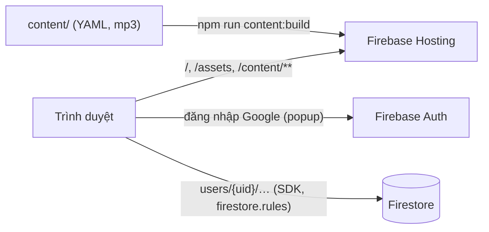

# DailyLearning

Web app học tiếng Anh ~15 phút mỗi ngày, tập trung **Đọc** và **Nghe** (A2 → B1). Chạy trên
**Firebase** và không có server riêng. Trang web (Firebase Hosting) đọc bài học từ file JSON tĩnh,
đăng nhập bằng Google và lưu tiến độ người học thẳng vào **Firestore**.

Kế hoạch: [`dailylearning-v1-plan.md`](.claude/plans/dailylearning-v1-plan.md) (v1) và
[`firebase-deploy-plan.md`](.claude/plans/firebase-deploy-plan.md) (chuyển sang Firebase).

## Kiến trúc



- **Bài học, từ điển, lộ trình**: `npm run content:build` biến `content/` thành
  `/content/data/*.json` và copy mp3. Các file này đi cùng bản build web lên Hosting, không nằm
  trong Firestore.
- **Tiến độ người học**: Firestore, mỗi người một nhánh `users/{uid}/…` (bảng dưới).
  `firestore.rules` chỉ cho chủ tài khoản đọc / ghi, và chỉ khi tài khoản có claim `learner` (xem
  [Cấp quyền cho người học](#cấp-quyền-cho-người-học)).
- **"API" chạy ngay trong trình duyệt**: các trang gọi `api('/lessons')`, `api('/reviews/due')`…
  và `apps/web/src/backend/` trả lời các path đó từ file JSON + Firestore. FSRS, chấm bài, streak và
  kế hoạch hôm nay đều tính ở trình duyệt. Kiểu dữ liệu chung: `packages/shared/src/api.ts`.
  Vì vậy đáp án câu hỏi và nghe chép nằm trong file JSON tải về (chấp nhận được với app học cá nhân).

| Firestore                           | Nội dung                                                 |
| ----------------------------------- | -------------------------------------------------------- |
| `users/{uid}`                       | tên chào, trình độ, mục tiêu phút mỗi ngày               |
| `users/{uid}/lessonProgress/{slug}` | trạng thái, bước, điểm của một bài                       |
| `users/{uid}/words/{lemma}`         | từ đã lưu + thẻ FSRS (id document = lemma đã encode URL) |
| `users/{uid}/dailyActivity/{ngày}`  | giây học, số bài, số lượt ôn trong ngày (giờ VN)         |
| `users/{uid}/answers/{id}`          | mọi câu trả lời (chỉ thêm, không sửa)                    |
| `users/{uid}/reviewLogs/{id}`       | mọi lượt chấm thẻ (chỉ thêm, không sửa)                  |

Dữ liệu người học tham chiếu nội dung bằng khóa tự nhiên (slug, lemma, key nghĩa), không dùng id
số. Id số trong file JSON là hash của khóa tự nhiên nên không đổi giữa các lần build.

## Yêu cầu

- **Node.js 22** qua [nvm](https://github.com/nvm-sh/nvm): `nvm install` rồi `nvm use` (đọc `.nvmrc`).
- **Java 21** cho Firebase Emulator (chạy local, test): `brew install openjdk@21`, rồi thêm vào
  `PATH`, ví dụ trong `~/.zshrc`: `export PATH="/opt/homebrew/opt/openjdk@21/bin:$PATH"`.
- **ffmpeg** (chỉ cần khi tạo audio): `brew install ffmpeg` (có kèm `ffprobe`).
- `firebase-tools` đã nằm trong devDependencies (`npx firebase …`), không cần cài global.

## Chạy local (emulator, không cần project Firebase thật)

```bash
nvm use
npm install
cp -n .env.example .env              # chỉ cần khi tạo audio (content:tts)

npm run dev                          # content:build + emulator Auth/Firestore + Vite
```

1. Mở **http://127.0.0.1:5173** → **Đăng nhập bằng Google**. Emulator không gọi Google thật:
   popup cho chọn hoặc thêm một tài khoản giả (**Add new account**, nhập email bất kỳ).
2. App báo "Chưa được cấp quyền". Ở terminal khác, cấp quyền cho email đó:

   ```bash
   npm run user:grant -- you@example.com --emulator --name Viet
   ```

3. Tải lại trang là vào app.

Tắt bằng Ctrl+C: dữ liệu emulator được lưu vào `tmp/emulator-data/` và nạp lại ở lần chạy sau. Xoá
thư mục đó để bắt đầu lại từ đầu. Emulator UI: http://127.0.0.1:4000. Cổng (`firebase.json`): Auth
9099, Firestore 8180, Hosting 5002 (chỉ e2e dùng).

## Deploy lên Firebase

### Lần đầu

1. [Firebase console](https://console.firebase.google.com) → tạo project. Gói **Spark** (miễn
   phí) là đủ; chỉ cần **Blaze** nếu muốn bật backup Firestore theo lịch.
2. **Firestore Database** → Create database → Native mode, location **`asia-southeast1`**
   (không đổi được về sau).
3. **Authentication** → Sign-in method → **Add new provider** → **Google** → Enable, chọn
   _support email_ → Save. `<project-id>.web.app` và `<project-id>.firebaseapp.com` có sẵn trong
   _Authorized domains_; dùng tên miền riêng thì thêm vào đó.
4. Gắn project vào repo (alias `prod`, `npm run deploy` mặc định dùng alias này) rồi deploy:

   ```bash
   npx firebase login
   npx firebase use <project-id> --alias prod     # hoặc: npx firebase use --add (hỏi đáp)
   npm run deploy                                 # build + Hosting + firestore.rules + indexes
   ```

5. Mở `https://<project-id>.web.app` → **Đăng nhập bằng Google** một lần để Firebase tạo tài
   khoản. App báo "Chưa được cấp quyền", đúng như mong đợi.
6. Cấp quyền cho chính mình: có dữ liệu cũ thì làm theo
   [Chuyển dữ liệu từ bản SQLite cũ](#chuyển-dữ-liệu-từ-bản-sqlite-cũ) (lệnh đó cấp quyền luôn),
   không thì theo [Cấp quyền cho người học](#cấp-quyền-cho-người-học). Xong tải lại trang.

Cấu hình Firebase của web lấy từ `/__/firebase/init.json` do Hosting tự phục vụ, nên không phải
điền gì vào code.

### Các lần sau

- **Bằng tay**: `npm run deploy` (project khác `prod`: `FIREBASE_PROJECT=<alias|id> npm run deploy`).
  Deploy từ đúng branch / commit muốn đưa lên: lệnh build từ code đang có trong thư mục.
- **Tự động** (chưa chạy thử): `.github/workflows/deploy.yml` deploy sau khi CI xanh trên `main`,
  chỉ khi repo có các biến (Settings → Variables) `FIREBASE_PROJECT_ID`,
  `GCP_WORKLOAD_IDENTITY_PROVIDER`, `GCP_SERVICE_ACCOUNT` (Workload Identity Federation, không
  dùng JSON key). Service account cần quyền deploy Hosting và Firestore rules / indexes (vd role
  _Firebase Admin_). Chưa đặt `FIREBASE_PROJECT_ID` thì workflow bỏ qua.
- **Rollback web**: console → Hosting → Release history → Rollback.

### Credential cho các script quản trị

`user:grant` và `migrate:sqlite` dùng Admin SDK nên cần credential khi chạy với `--project`:
console → Project settings → Service accounts → **Generate new private key**, lưu vào `secrets/`
(đã gitignore; pre-commit chặn file JSON có `private_key`):

```bash
export GOOGLE_APPLICATION_CREDENTIALS=secrets/<file>.json
```

Dùng xong thì xoá file key (và thu hồi key trong console nếu không cần nữa). Với `--emulator`
không cần credential.

## Cấp quyền cho người học

Ai có tài khoản Google cũng đăng nhập được, nhưng chỉ tài khoản có custom claim `learner` mới đọc /
ghi được dữ liệu. Người chưa được cấp quyền chỉ thấy trang **"Chưa được cấp quyền"**.

```
Người học: mở site → "Đăng nhập bằng Google" → thấy "Chưa được cấp quyền"
Anh:       npm run user:grant -- <email> --project <project-id>
Người học: tải lại trang → vào app, bắt đầu từ Ngày 1 (tiến độ, sổ từ trống)
```

### Cấp quyền

1. Nhờ người học **đăng nhập Google trên site một lần** để Firebase tạo tài khoản. Chưa có tài
   khoản thì lệnh dưới báo `No account for <email> …`.
2. Đặt `GOOGLE_APPLICATION_CREDENTIALS` (mục
   [Credential](#credential-cho-các-script-quản-trị)), rồi:

   ```bash
   npm run user:grant -- ban.hoc@gmail.com --project <project-id>
   npm run user:grant -- ban.hoc@gmail.com --project <project-id> --name "Lan"   # đặt tên chào
   ```

   Lệnh gán claim `learner` và tạo profile `users/{uid}` nếu chưa có. Tên chào lấy từ `--name`,
   không có thì lấy tên tài khoản Google. Chạy lại không ảnh hưởng dữ liệu học; `--name` thì đổi
   tên chào.

3. Báo người học **tải lại trang** là vào được (không cần đăng xuất).

### Thu hồi quyền

```bash
npm run user:grant -- ban.hoc@gmail.com --project <project-id> --revoke
```

Phiên đang mở vẫn dùng được tới khi ID token hết hạn (tối đa khoảng 1 giờ); lần đăng nhập sau thì
bị chặn ngay. Disable account trong console (Authentication → Users) cũng không cắt được token đang
còn hạn. Dữ liệu học vẫn nằm trong Firestore; cấp quyền lại là dùng tiếp.

### Xem ai đang có quyền

```bash
npm run user:grant -- --list --project <project-id>
```

In các tài khoản có claim `learner` (console không hiển thị custom claim). Danh sách mọi tài khoản
đã từng đăng nhập: console → Authentication → Users.

## Chuyển dữ liệu từ bản SQLite cũ

Trước khi lên Firebase, app chạy local và lưu tiến độ trong `data/app.db`. Lệnh dưới chép tiến độ
của một người học sang Firestore và cấp quyền luôn cho tài khoản nhận:

```bash
# Tài khoản nhận phải đã đăng nhập Google trên site một lần. Cần credential (mục trên).
npm run migrate:sqlite -- --project <project-id> --email you@gmail.com --dry-run   # chỉ đếm
npm run migrate:sqlite -- --project <project-id> --email you@gmail.com
```

- Script chỉ đọc `data/app.db` (tuỳ chọn `--db <file>`; DB có nhiều người thì chọn bằng
  `--sqlite-user <id>`).
- Cuối output có dòng `In Firestore now (found/copied): …`, các cặp số phải bằng nhau.
- Tải lại trang: tên chào, tiến độ bài, sổ từ và lịch ôn giống bản cũ.

> ⚠️ **Chỉ chạy một lần, trước khi học trên bản Firebase.** Script ghi đè các document cùng id
> (thẻ từ, tiến độ bài, hoạt động theo ngày) bằng dữ liệu trong SQLite, nên chạy lại sau khi đã học
> trên web sẽ đưa lịch ôn về trạng thái cũ. Từ lúc chuyển xong, chỉ học trên bản Firebase.

## Thêm bài học mới

Quy trình soạn bài (kế hoạch mục 2.5):

1. Viết `content/lessons/a2/<slug>/lesson.yaml` (bài, bản dịch, câu hỏi, nghe chép, focus words,
   `senses`, `ignore`) và thêm bài vào `content/daily-plan.yaml` nếu muốn đưa vào lộ trình.
2. `npm run content:check-dict <slug>` → liệt kê token chưa có trong từ điển và từ nhiều nghĩa chưa
   được chọn nghĩa.
3. Tạo các file `content/dictionary/<lemma>.yaml` còn thiếu (`status: draft`), chọn nghĩa đúng câu
   trong bài (`senses: { run: manage }`, lần xuất hiện thứ 2: `run#2: move`).
4. Duyệt lại → đổi sang `status: reviewed`.
5. `npm run content:tts -- <slug>` và `npm run content:tts-words` (mục dưới).
6. `npm run content:check` phải báo OK trước khi commit (CI cũng chạy lệnh này).
7. `npm run deploy` để đưa bài lên site.

Đừng xoá file từ điển của một từ người học đã lưu: từ đó sẽ biến mất khỏi sổ từ và hàng ôn (dữ
liệu trong Firestore vẫn còn, thêm lại file là hiện lại), nhưng vẫn được đếm trong số thẻ đến hạn
ở sidebar.

Schema: `packages/shared/src/content.ts`. Quy tắc tách từ: `packages/content/src/content/tokenizer.ts`
(cụm dài nhất trước, dạng từ → từ gốc, `ignore`, bỏ qua số; từ viết tắt như `it's` / `I'll` là entry
riêng, `there's` là dạng của `there is`).

## Tạo audio (chạy trên Mac)

Audio tạo một lần bằng Google Cloud Text-to-Speech (kế hoạch 2.4) rồi commit vào git; app không gọi
TTS khi đang học. Cần `GOOGLE_TTS_API_KEY` trong `.env` (API key chỉ cho phép Text-to-Speech API).
Trước lần chạy đầu, đặt **budget alert** trong Google Cloud Billing (ví dụ 1 USD).

Chạy theo thứ tự:

```bash
brew install ffmpeg                          # ffmpeg + ffprobe (script kiểm tra lúc bắt đầu)

npm run content:tts:voices -- --sample       # liệt kê giọng + 8 file nghe thử trong tmp/voice-samples/
open tmp/voice-samples                       # nghe rồi sửa content/tts.config.yaml
                                             # (speakerA, speakerB, narrator, word)

npm run content:tts -- --all --dry-run       # chỉ đếm ký tự, không gửi gì
npm run content:tts -- --all                 # audio.mp3 + timings.json cạnh mỗi lesson.yaml

npm run content:tts-words -- --dry-run       # tùy chọn: đếm trước
npm run content:tts-words                    # content/words/<lemma-slug>.mp3

npm run content:check                        # kiểm tra lại toàn bộ nội dung

git add content && git commit -m "content: add lesson and word audio"
npm run deploy
```

Cách hoạt động:

- Mỗi câu một clip (giọng A/B cho bài nghe, giọng `narrator` cho bài đọc), ghép bằng ffmpeg với
  `gapMs` khoảng lặng, chuẩn hóa MP3 mono 64 kbps. `timings.json` chứa mốc từng câu (đo bằng
  ffprobe), thời lượng và 80 điểm waveform; `content:build` đưa chúng vào JSON của bài.
- Mỗi lần chạy in số ký tự sẽ gửi và dừng trước khi gọi API nếu vượt `TTS_MAX_CHARS` (mặc định
  50000). `--dry-run` chỉ in số ký tự (không cần key, không cần ffmpeg).
- Cache: `content/.tts-cache.json` + `content/.tts-clips/` (đều gitignore). Clip đã có không gửi lại.
  Bài có `timings.json` khớp nội dung được bỏ qua; đổi giọng thì dùng `--force` (chỉ tạo lại clip của
  giọng mới).
- Giọng Chirp 3 HD chỉ nhận văn bản thường và bỏ qua `speakingRate`; Neural2 và WaveNet dùng
  `speakingRate` trong `content/tts.config.yaml`. Tên giọng được kiểm tra với danh sách của Google
  trước khi tạo.
- Thử không cần Google: `--provider fake --out <thư mục tạm>` ghi âm thử bằng ffmpeg vào bản sao
  `content/` trong thư mục đó (không bao giờ ghi vào `content/` của repo).
- `content:build` chỉ copy `audio.mp3`, ảnh bìa và `words/*.mp3` sang `/content/` (không bao giờ
  YAML, `timings.json` hay cache). URL audio có `?v=<hash file>` nên Hosting cho cache 1 năm; JSON
  trong `/content/data/` thì `no-cache` (trình duyệt hỏi lại server mỗi lần mở app).

## Lệnh

| Lệnh                                | Tác dụng                                                                             |
| ----------------------------------- | ------------------------------------------------------------------------------------ |
| `npm run dev`                       | `content:build` + emulator Auth/Firestore + Vite (http://127.0.0.1:5173)             |
| `npm run emulators`                 | Chỉ emulator (dữ liệu giữ ở `tmp/emulator-data/`)                                    |
| `npm run build`                     | `content:build` + build web vào `apps/web/dist` (đúng thứ được deploy)               |
| `npm run deploy`                    | Build rồi deploy Hosting + Firestore rules / indexes lên alias `prod`                |
| `npm run lint` / `typecheck`        | ESLint / `tsc --noEmit` (mọi workspace + `e2e/`)                                     |
| `npm test`                          | Vitest: web (component, a11y, logic FSRS / streak / kế hoạch) + tooling nội dung     |
| `npm run test:emulator`             | Backend trong trình duyệt + `firestore.rules`, chạy trên emulator                    |
| `npm run test:e2e`                  | Build bản `e2e`, chạy Playwright trên emulator Hosting + Auth + Firestore            |
| `npm run content:build`             | Validate `content/`, ghi `apps/web/public/content/` (JSON + mp3)                     |
| `npm run content:check`             | Chỉ validate, không ghi gì (CI)                                                      |
| `npm run content:check-dict [slug]` | Từ trong bài chưa có trong từ điển, từ nhiều nghĩa chưa chọn nghĩa                   |
| `npm run content:stats`             | Số entry, % `reviewed`, độ phủ Oxford 3000, số bài                                   |
| `npm run content:tts:voices`        | Liệt kê giọng en-US (`-- --sample`: file nghe thử trong `tmp/voice-samples/`)        |
| `npm run content:tts -- <slug>`     | Audio bài: `audio.mp3` + `timings.json` (`--all`, `--dry-run`, `--force`)            |
| `npm run content:tts-words`         | Phát âm từ `content/words/<lemma>.mp3` cho từ chưa có audio                          |
| `npm run user:grant -- <email> …`   | Cấp quyền (`--revoke` thu hồi, `--list` liệt kê); `--emulator` hoặc `--project <id>` |
| `npm run migrate:sqlite -- …`       | Chép tiến độ từ `data/app.db` cũ sang Firestore (`--dry-run` để đếm trước)           |
| `npm run format`                    | Prettier (ghi); `format:check` chỉ kiểm tra                                          |

## Cấu trúc thư mục

```
apps/web/          React 18 + Vite
  src/backend/     "API" chạy trong trình duyệt: router, handlers, userStore (Firestore), content
  src/api/         api('/…') + hook TanStack Query mà các trang dùng
  src/pages/ …     giao diện
  test/            component + logic (jsdom); test/emulator/: backend + rules trên emulator
packages/shared/   kiểu API, kiểu file nội dung (content-data), schema YAML (zod)
packages/content/  tooling nội dung: đọc / validate YAML, tách từ, content:build, TTS
content/           bài học, từ điển, lộ trình, audio (nguồn của content:build)
scripts/           content-*.ts, tts*.ts, user-grant.ts, migrate-sqlite-to-firestore.ts, emulators.mjs
e2e/               Playwright (đăng nhập Google → đọc → nghe → ôn từ → đăng xuất)
firebase.json      Hosting (rewrite SPA, cache header), Firestore, cổng emulator
firestore.rules    quyền truy cập Firestore
```

## Kiểm thử

- `npm test`: component + a11y (axe-core, jsdom), logic FSRS / streak / kế hoạch hôm nay, tooling
  nội dung. Không cần emulator.
- `npm run test:emulator`: các handler của backend (bài học, chấm bài, tiến độ, lưu từ, ôn FSRS,
  hoãn, trang chủ, heartbeat) và `firestore.rules` trên emulator Auth + Firestore. CI chạy cả lệnh
  này.
- `npm run test:e2e`: lần đầu cài trình duyệt bằng `npx playwright install chromium`. Build web ở
  mode `e2e`, khởi động emulator Hosting + Auth + Firestore (trống, bỏ đi sau khi chạy) rồi chạy
  luồng: đăng nhập Google (tài khoản chưa cấp quyền bị chặn, rồi tài khoản đã cấp quyền) → Trang
  chủ → bài đọc → bài nghe → Ôn từ → tải lại trang → Đăng xuất. Báo cáo:
  `npx playwright show-report`. Không nằm trong CI.

## Xử lý sự cố

- **Đã deploy nhưng site vẫn như cũ**: `npm run deploy` build từ code đang có trong thư mục chạy
  lệnh; kiểm tra branch / commit (`git log -1`). Code đúng rồi thì tải lại trang bằng Cmd+Shift+R.
- **Bấm "Đăng nhập bằng Google" báo `auth/operation-not-allowed`**: chưa bật provider Google
  (Deploy → Lần đầu, bước 3).
- **`auth/unauthorized-domain`**: tên miền đang mở chưa có trong Authentication → Settings →
  Authorized domains.
- **Báo trình duyệt chặn cửa sổ đăng nhập**: cho phép popup cho site rồi bấm lại.
- **Đăng nhập được nhưng báo "Chưa được cấp quyền"**: tài khoản chưa có claim `learner`. Chạy
  `npm run user:grant -- <email> --project <id>` (hoặc `migrate:sqlite`), rồi tải lại trang.
- **`No account for <email>`** khi chạy `user:grant` / `migrate:sqlite`: email đó chưa đăng nhập
  Google trên site lần nào (hoặc gõ sai email).
- **Script quản trị báo lỗi credential** (`Could not load the default credentials`…): chưa đặt
  `GOOGLE_APPLICATION_CREDENTIALS` (mục Credential).
- **`Could not start … Emulator, port taken`**: cổng trong `firebase.json` đang bị chiếm
  (`lsof -nP -iTCP:<port> -sTCP:LISTEN`). Firestore dùng 8180 vì 8080 hay bị nginx / app khác dùng.
- **`Unable to locate a Java Runtime`**: cài Java 21 và thêm vào `PATH` (mục Yêu cầu).
- **"Không tải được nội dung bài học (catalog.json …)"** khi chạy `vite` riêng: chưa build nội
  dung, chạy `npm run content:build` (hoặc dùng `npm run dev`).
- **Thiếu ffmpeg** (`ffmpeg not found` khi chạy `content:tts`): `brew install ffmpeg`, kiểm tra bằng
  `ffmpeg -version` và `ffprobe -version`.

## Pre-commit hook

Chạy ESLint + Prettier cho file được stage và chặn:

- file media (mp3, webp, png, jpg, …) lớn hơn 5 MB
- file `*.json` chứa `private_key` (key service account để trong `secrets/`, đã gitignore)
